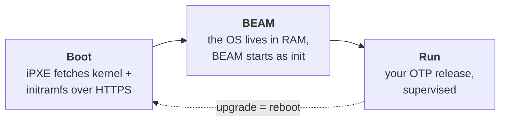

## Where do you pour your elixir ? In a *Cubi, pardi !*

cubi runs your elixir app as close as possible to the bare metal.

Boot a bare metal server, a VM, an EC2 instance with a secure, read-only OS and deploy your elixir application on top of it.

A linux kernel, a BEAM, and that's all !

To upgrade a node, reboot it.

## How it works



### Boot: nothing to flash

Nodes boot from the network. iPXE downloads a kernel and an initramfs that holds
a squashfs of the whole system: Linux, ERTS and your release. The machine comes
up straight into BEAM. The OS lives in RAM and is thrown away at every reboot,
as on SmartOS.

The image is built from a [Nerves](https://nerves-project.org/) system for
x86_64. `mix firmware.ipxe` converts the usual `.fw` into the three files that
the boot server serves: `vmlinuz`, `stage1.cpio.zst` and `rootfs.squashfs`.

### Deploy and upgrade: reboot

Your application is deployed onto a running node, without a reboot.
You sign the release with your own CA (`mix cubi.release`, `mix cubi.sign`) and
send it over ssh (`mix cubi.deploy <node>`). The node checks the signature
against the CA built into its image, starts the release, and goes back to the
previous one if it crashes ([docs/specs.md](docs/specs.md) §2.11).

### Run it in the cloud

*[Milestone 2](docs/milestone2.md), not built yet.*

You don't need to build an image to run cubi on a cloud VM, a VPS or a rented
server. The cubi project publishes one kernel, stage-1 and rootfs per version,
the same for everyone, with no CA and no ssh key inside. What makes a node
yours is a short private iPXE script, handed to the provider through its API:

```ipxe
#!ipxe
set base https://…/cubi/<version>
kernel ${base}/vmlinuz console=ttyS0 cubi.rootfs=sha256:<hex> cubi.ca=sha256:<hex> cubi.ssh=ssh-ed25519:<base64>
initrd ${base}/stage1.cpio.zst
initrd ${base}/rootfs.squashfs /rootfs.squashfs
boot
```

The script pins the rootfs by its hash and your CA by its fingerprint, and
names the ssh keys allowed to log in. None of that is secret, but whoever
writes the script decides what the node runs, so it never sits at a public URL.

`mix cubi.provision <name> --provider vultr` renders the script, creates the
instance and waits for ssh; `mix cubi.deploy <name> --provider vultr` then
deploys your signed release as above. `mix cubi.instances`, `mix cubi.upgrade`
(a reboot onto another version) and `mix cubi.destroy` do the rest. Providers
sit behind a `Cubi.Provider` behaviour: QEMU locally, and Vultr first among
the clouds ([docs/specs.md](docs/specs.md) §2.12).

## Is it for you?

cubi is a good fit when:

- your workloads are BEAM releases, such as Elixir, Erlang or Gleam apps;
- you run on machines you control (bare metal, or VMs that can boot over the
  network), or on cloud instances that boot an iPXE script;
- you prefer a few things you understand well to a large platform.

## Quickstart

### Prerequisites

- Elixir 1.20 and the `nerves_bootstrap` archive
  (`mix archive.install hex nerves_bootstrap`);
- `fwup` and `squashfs-tools` (`unsquashfs`, `mksquashfs`), and `openssl` to
  sign images;
- QEMU for x86_64 with its iPXE NIC ROMs (`qemu-system-x86`, `ipxe-qemu` on
  Debian/Ubuntu), and read-write access to `/dev/kvm`;
- `libmnl-dev`, only for host builds of `cubi_fw` (a root `mix test`).

The Nerves system is a git submodule:

```sh
git submodule update --init
```

### Build an iPXE directory

`mix firmware.ipxe` runs `mix firmware`, then turns the `.fw` into the
directory a boot server serves:

```sh
cd apps/cubi_fw
export MIX_TARGET=x86_64
export BR2_PRIMARY_SITE=https://sources.buildroot.net
mix deps.get
mix firmware.ipxe
```

The first build compiles the Nerves system with Buildroot, which takes about an
hour. It is cached in `~/.nerves/artifacts` afterwards. `BR2_PRIMARY_SITE` is
needed because some upstream source URLs are dead; Buildroot still checks every
hash.

The output lands in `_build/<target>_<env>/ipxe/` at the repository root, so
`_build/x86_64_dev/ipxe/` by default:

| File | What |
| --- | --- |
| `vmlinuz` | the kernel |
| `stage1.cpio.zst` | the stage-1 initramfs, which loop-mounts the rootfs and starts BEAM |
| `rootfs.squashfs` | Linux userland, ERTS and the release, plus the firmware metadata |
| `boot.ipxe` | the iPXE script, with relative URLs: serve the directory from anywhere |
| `base.json` | the OTP version and applications in the image, for building releases against it |
| `*.sig` | signatures of the three images, when built with a signer |
| `SHA256SUMS` | checksums of every file above |

`--cmdline "console=ttyS0 …"` sets the kernel arguments written into
`boot.ipxe` (default `console=ttyS0`).

`--signer DIR` signs the images with the signer from `mix cubi.gen_ca`
(in `apps/cubi_tools`; `~/.cubi/pki` by default). A `dev` build may be
unsigned; other environments refuse to build without a signer. The image
trusts your root CA for deployed releases ([docs/specs.md](docs/specs.md)
§2.11.2).

Which ssh keys the image trusts depends on `MIX_ENV`:

- **`dev`** (default) trusts your `~/.ssh/id_{rsa,ecdsa,ed25519}.pub`;
- **`e2e`** trusts only the test harness key, and is signed by a test CA.
  Create both once with `mix cubi.e2e.key` in `apps/cubi_e2e`, then build with
  `MIX_ENV=e2e mix firmware.ipxe`. The output is in `_build/x86_64_e2e/ipxe/`.

### Boot it in QEMU

QEMU's user-mode network has a built-in DHCP and TFTP server, and its NIC ROMs
are iPXE, so a diskless VM can boot the directory as is. No root is needed:

```sh
qemu-system-x86_64 -enable-kvm -m 1024 -nographic -boot n \
  -device virtio-net-pci,netdev=n0 \
  -netdev user,id=n0,tftp=_build/x86_64_dev/ipxe,bootfile=boot.ipxe,hostfwd=tcp:127.0.0.1:2222-:22
```

The serial console ends at the IEx prompt. `Ctrl-a x` quits QEMU. Give the VM
at least 1 GiB: the rootfs lives in RAM.

The same over HTTP, which is how a real boot server serves the files:

```sh
(cd _build/x86_64_dev/ipxe && python3 -m http.server 8000 --bind 127.0.0.1) &
qemu-system-x86_64 -enable-kvm -m 1024 -nographic -boot n \
  -device virtio-net-pci,netdev=n0 \
  -netdev user,id=n0,bootfile=http://10.0.2.2:8000/boot.ipxe
```

`10.0.2.2` is the host as the guest sees it.

The `hostfwd` in the first command forwards host port 2222 to the node's ssh,
which runs Elixir rather than a shell:

```sh
ssh -p 2222 localhost 'Nerves.Runtime.firmware_validation_status()'
# e2e image:
ssh -p 2222 -i apps/cubi_e2e/priv/harness_key/id_ed25519 localhost '…'
```

These commands boot under BIOS (SeaBIOS). UEFI netboot (OVMF with
`ipxe.efi`) is [phase 4](docs/phase4.md) and does not work yet.

### Run the tests

The automated tests boot the `e2e` image in QEMU, so build it first (see
[above](#build-an-ipxe-directory)), then:

```sh
cd apps/cubi_e2e
mix test                    # unit tests
mix test --only e2e:tier1   # boots VMs from _build/x86_64_e2e/ipxe/
```

Each test keeps its serial log, QMP log and QEMU argv in
`_build/e2e/<module>/<test>/`. The harness is described in
[docs/testing.md](docs/testing.md).

## Roadmap

Each phase ends with an acceptance test, automated as described in
[docs/testing.md](docs/testing.md).

| Phase | Scope |
| --- | --- |
| [0](docs/phase0.md) | Confirm the assumptions |
| [1](docs/phase1.md) | Boot by hand in QEMU, no iPXE |
| [2](docs/phase2.md) | The Nerves system fork |
| [3](docs/phase3.md) | `mix firmware.ipxe` |
| [4](docs/phase4.md) | Network boot in QEMU |
| [5](docs/phase5.md) | Hardened boot chain |
| [6](docs/phase6.md) | Storage: ZFS and Khepri |
| [M1](docs/milestone1.md) | Signed releases deployed to standalone nodes, no distribution |
| [M2](docs/milestone2.md) | Cloud instances from public images, a private iPXE script and `Cubi.Provider` |
| [7](docs/phase7.md) | Plug into cubi: join, leave, membership |
| [8](docs/phase8.md) | Real hardware |

## Documentation

- [docs/architecture.md](docs/architecture.md): the cluster manager design (join, leave, membership, security)
- [docs/specs.md](docs/specs.md): node boot specification (iPXE, stage-1 init, credentials, Khepri, ZFS)
- [docs/questions.md](docs/questions.md): open questions
- [docs/testing.md](docs/testing.md): test strategy and harness
