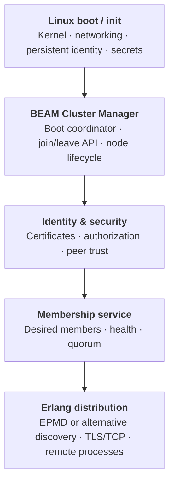
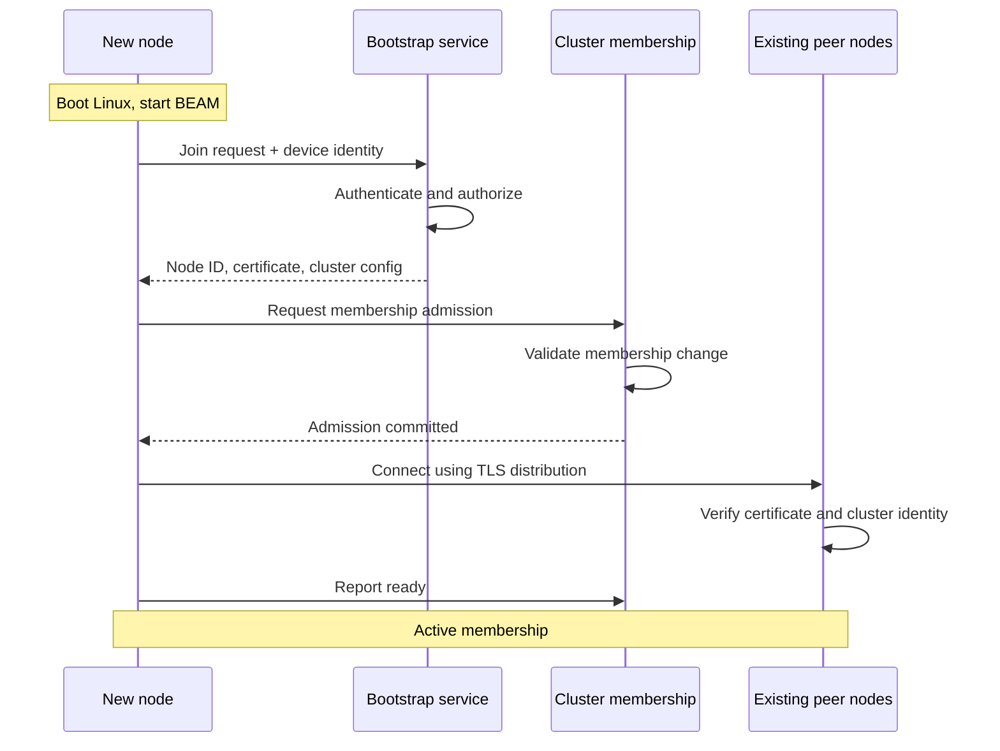
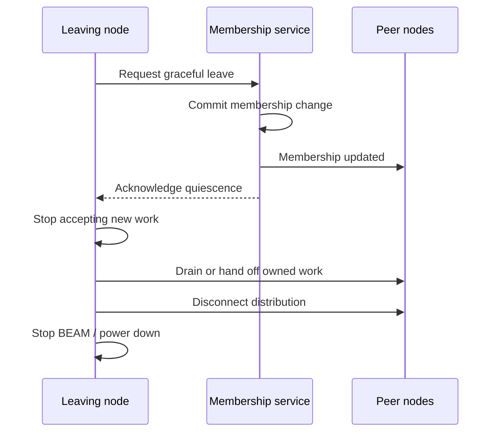
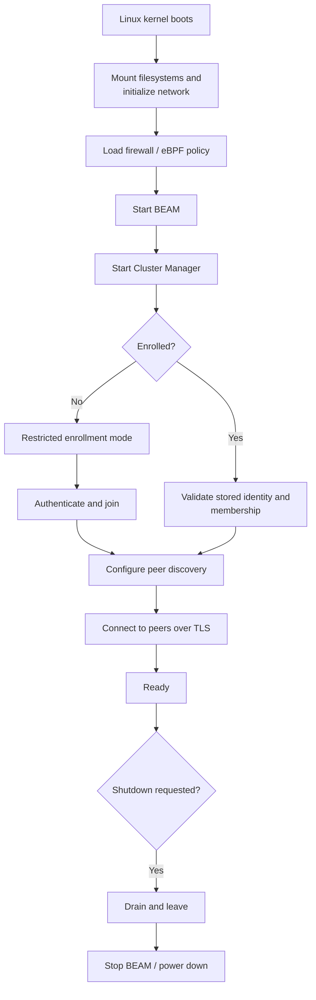

For a non-Kubernetes Erlang cluster, especially with your Nerves-style idea of booting Linux directly into BEAM, I'd design a small Erlang Cluster Manager that provides the equivalent of `kubeadm join` and `kubeadm leave`.

The central design choice is to separate node lifecycle management, cluster membership, and Erlang distribution. Starting a BEAM node should not automatically mean that it is trusted or admitted to the cluster.

## 1. Proposed architecture



I'd keep the manager as an OTP application running under the main BEAM instance, rather than immediately introducing a second runtime. A minimal Linux image can launch BEAM as PID 1, provided you handle signal delivery, child reaping, shutdown and supervision appropriately.

The manager can be responsible for orchestrating membership, but it should not itself be the sole authority for cluster membership if it is also a single point of failure.

## 2. Equivalent of `kubeadm join`

I'd define a bootstrap protocol that admits a new machine in explicit stages.



The important distinction is that receiving credentials is not the same as becoming a cluster member.

### Join API

For example, the manager could expose these operations:

```
Cluster.join(bootstrap_endpoint, enrollment_token)
Cluster.leave(mode: :graceful)
Cluster.status()
Cluster.members()
```

The API is illustrative, not an existing library API.

A node should have a persistent identity independent of its Erlang node name or IP address. During enrollment, it obtains a certificate and configuration, then requests admission into the authoritative membership set.

For unattended devices, I'd use a unique device key stored in protected persistent storage, ideally backed by a TPM where available. Use short-lived enrollment tokens or signed enrollment requests instead of sharing one cluster-wide join secret.

## 3. Equivalent of `kubeadm leave`

A graceful leave should be a protocol, not just a call to `init:stop/0`.



I would support two modes:

- Graceful leave: stop new work, hand off responsibility, commit the membership change, and shut down.
- Forced removal: revoke the node's authorization and remove it from the membership set after failure or compromise.

A forced removal cannot guarantee that the node is physically stopped. It may be partitioned from the cluster but still running locally. This is why leases, fencing tokens, and application-level ownership checks matter for systems that control hardware or write shared state.

## 4. Membership: don't confuse connectivity with consensus

This is the most important architectural decision.

Erlang distribution can tell you whether a peer is connected, but it does not decide a safe, authoritative cluster membership on its own.

I'd choose one of these approaches:

| Approach                                     | Suitable for                                                                |
| -------------------------------------------- | --------------------------------------------------------------------------- |
| Static configuration + trusted peers         | Small, fixed cluster                                                        |
| Bootstrap server + signed membership records | Small deployments where temporary enrollment-service outages are acceptable |
| Consensus-backed membership                  | Dynamic cluster where nodes must agree on membership and survive failures   |
| Gossip / eventual membership                 | Large, elastic cluster where temporary disagreement is acceptable           |

For a dynamic cluster with safe membership changes, I would use Raft for the membership control plane, keeping it separate from Erlang's distribution connections.

A few implications:

- A three-voter Raft group tolerates one voter failure.
- A five-voter group tolerates two voter failures.
- Membership changes themselves must be committed through the consensus protocol.
- Don't automatically add every discovered node as a voter; separate cluster members from consensus voters.

If the cluster manages durable shared data, membership changes and data ownership changes need their own carefully defined consistency semantics.

## 5. eBPF security without Kubernetes

For the Linux networking layer, I would start with a dedicated interface or VLAN for cluster traffic, host firewall rules, and optionally custom eBPF programs.

You don't need Cilium just to use eBPF. Cilium can operate outside Kubernetes, but its non-Kubernetes deployment introduces additional dependencies and operational complexity.&#x20;

[image](https://www.google.com/s2/favicons?domain=https://github.com\&sz=32)

GitHub+1


A sensible first implementation is:

- Bind Erlang distribution to a fixed TCP port.
- Restrict inbound distribution connections to the cluster network.
- Use mutual TLS for node authentication and encryption.
- Have the cluster manager update firewall policy when a node is admitted or revoked.
- Use eBPF telemetry for visibility, then add custom enforcement only where necessary.

One subtlety: EPMD's default protocol exposes node names and distribution ports to unauthenticated lookup requests. You can reduce that exposure by restricting port `4369`, or replace EPMD discovery with a custom discovery module. Erlang/OTP supports alternative discovery modules through `-epmd_module`.&#x20;

[image](https://www.google.com/s2/favicons?domain=https://www.erlang.org\&sz=32)

OTP 27.3.4.18 (erts 15.2.7.13)+1


## 6. A Nerves-style boot sequence

For an appliance-like cluster node, I'd use the following lifecycle:



I would not start a full Erlang distribution listener before the node has loaded its identity and security configuration. If you use BEAM as PID 1, make sure it also handles Linux signals and reaps child processes; a small init process is an alternative if you want to keep those responsibilities outside the VM.

## 7. A concrete first version

I'd build the first release from four components:

| Component            | Responsibility                                      |
| -------------------- | --------------------------------------------------- |
| `cluster_boot`       | Boot state machine, persistent identity, enrollment |
| `cluster_membership` | Authoritative membership and admission/removal      |
| `cluster_security`   | Certificates, TLS policy, firewall integration      |
| `cluster_discovery`  | Peer lookup and Erlang distribution integration     |

For discovery, implementing OTP's alternative EPMD interface lets you query the membership service for node addresses and distribution ports rather than running a conventional EPMD service.&#x20;

[image](https://www.google.com/s2/favicons?domain=https://www.erlang.org\&sz=32)

OTP 27.3.4.18 (erts 15.2.7.13)+1


My recommendation: build a small OTP-based manager with signed enrollment, TLS distribution, and explicit membership states first. Add Raft when you need fault-tolerant authoritative membership, and eBPF enforcement when you have a concrete host-network security requirement. This gives you a `kubeadm join/leave` experience without recreating all of Kubernetes.