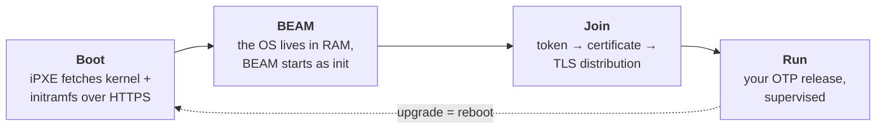

# kubex

**Do you really need Kubernetes for your BEAM apps?**

kubex runs Elixir and Erlang applications on a cluster without Kubernetes. You
boot your nodes, they join a cluster, and your app runs on them. Each node is
Linux plus BEAM. Nothing else runs on it.

To upgrade a node, reboot it.

> **Status: phase 3 of 8.** A node image builds and boots to IEx in QEMU, from
> a directory iPXE can serve ([Quickstart](#quickstart)). Clustering (join,
> membership, storage) is not built yet. The design is in
> [docs/specs.md](docs/specs.md), and the work plan is the set of phases
> [below](#roadmap).

---

## Why

A Kubernetes control plane needs about 2 GB of RAM for its core services before
your application starts. Most of what it gives you, the BEAM already has:

| Kubernetes | What the BEAM already gives you |
| --- | --- |
| Deployment, ReplicaSet, restart policies | Supervisors, `gen_server`, OTP applications |
| CoreDNS, Services, service discovery | Erlang distribution, `Registry`, `:global`, `:pg` |
| Ingress controllers, Traefik, Gateway API, EndpointSlices | Plug (and Bandit or Cowboy) in your release |
| etcd | [Khepri](https://github.com/rabbitmq/khepri), Raft through Ra, inside the BEAM |
| Container images | An OTP release, built with `mix firmware` |
| `kubeadm join` / `kubeadm leave` | `kubex.join=` on the kernel cmdline, plus a graceful leave protocol |
| Node OS upgrades, image rollouts | The boot server serves a new image, and the node reboots |

On a Kubernetes cluster, each layer of that stack is a separate project that you
deploy, configure and upgrade. In kubex the BEAM does that work, and kubex adds
what it is missing: a way to boot a node, admit it into the cluster securely,
and keep an agreed list of members.

## How it works



### Boot: nothing to flash

Nodes boot from the network. iPXE downloads a kernel and an initramfs that holds
a squashfs of the whole system: Linux, ERTS and your release. The machine comes
up straight into BEAM. The OS lives in RAM and is thrown away at every reboot,
as on SmartOS.

The image is built from a [Nerves](https://nerves-project.org/) system for
x86_64. `mix firmware.ipxe` converts the usual `.fw` into the three files that
the boot server serves: `vmlinuz`, `stage1.cpio.zst` and `rootfs.squashfs`.

### Join: membership is explicit

When BEAM starts on a node, the node is not yet a member of the cluster. A node
joins in explicit steps:

1. The boot server gives the node the address of the cluster (`kubex.join=`) and
   a join token for that node only. The token is delivered as an initrd file,
   never on the kernel cmdline.
2. The cluster checks the token and issues the node a certificate.
3. The node connects to its peers over Erlang distribution with mutual TLS. Each
   peer checks the certificate during the handshake.
4. The cluster's Khepri store records the node as a member.

The first node creates the cluster from a single-use bootstrap secret
(`kubex.bootstrap=`). A node can leave gracefully (it stops taking new work,
hands its work off, and then the membership change is committed), or an operator
can remove it by force by revoking its certificate.

### State: Khepri on ZFS, only where there are disks

There are two kinds of node:

| Node | Disks | Role |
| --- | --- | --- |
| **storage** | named on the cmdline with `kubex.vdevs=` | holds a ZFS pool, runs a Khepri member, can vote in Raft, and keeps its identity across reboots |
| **diskless** | none | runs workloads, reaches the store through a storage node, and rejoins with a fresh identity on every boot |

Cluster state (members, certificates, the CA, join tokens and config) is stored
in Khepri, on a ZFS dataset reserved for kubex. Raft needs durable storage, so
only storage nodes vote. To survive the loss of one node, a cluster needs three
storage nodes.

### Deploy and upgrade: reboot

Your application ships in the image. To deploy a new version, you build the
image, publish it on the boot server, and reboot the nodes. The boot server
chooses which version each node boots, so promoting a version, testing it on a
few nodes first and rolling it back are all done on the boot server. Nodes have
no A/B partitions and no package manager.

Your application can also be deployed onto a running node, without a reboot.
You sign the release with your own CA (`mix kubex.release`, `mix kubex.sign`) and
send it over ssh (`mix kubex.deploy <node>`). The node checks the signature
against the CA built into its image, starts the release, and goes back to the
previous one if it crashes ([docs/specs.md](docs/specs.md) §2.11).

## Is it for you?

kubex is a good fit when:

- your workloads are BEAM releases, such as Elixir, Erlang or Gleam apps;
- you run on machines you control (bare metal, or VMs that can boot over the
  network);
- you prefer a few things you understand well to a large platform.

It is not a good fit when you need to run containers for other languages, mix
workloads from several teams with resource quotas, or use the Kubernetes
ecosystem: Helm, operators, managed cloud integrations.

## Quickstart

### Prerequisites

- Elixir 1.20 and the `nerves_bootstrap` archive
  (`mix archive.install hex nerves_bootstrap`);
- `fwup` and `squashfs-tools` (`unsquashfs`, `mksquashfs`), and `openssl` to
  sign images;
- QEMU for x86_64 with its iPXE NIC ROMs (`qemu-system-x86`, `ipxe-qemu` on
  Debian/Ubuntu), and read-write access to `/dev/kvm`;
- `libmnl-dev`, only for host builds of `kubex_fw` (a root `mix test`).

The Nerves system is a git submodule:

```sh
git submodule update --init
```

### Build an iPXE directory

`mix firmware.ipxe` runs `mix firmware`, then turns the `.fw` into the
directory a boot server serves:

```sh
cd apps/kubex_fw
export MIX_TARGET=x86_64
export BR2_PRIMARY_SITE=https://sources.buildroot.net
mix deps.get
mix firmware.ipxe
```

The first build compiles the Nerves system with Buildroot, which takes about an
hour. It is cached in `~/.nerves/artifacts` afterwards. `BR2_PRIMARY_SITE` is
needed because some upstream source URLs are dead; Buildroot still checks every
hash.

The output lands in `_build/<target>_<env>/ipxe/` at the repository root, so
`_build/x86_64_dev/ipxe/` by default:

| File | What |
| --- | --- |
| `vmlinuz` | the kernel |
| `stage1.cpio.zst` | the stage-1 initramfs, which loop-mounts the rootfs and starts BEAM |
| `rootfs.squashfs` | Linux userland, ERTS and the release, plus the firmware metadata |
| `boot.ipxe` | the iPXE script, with relative URLs: serve the directory from anywhere |
| `base.json` | the OTP version and applications in the image, for building releases against it |
| `*.sig` | signatures of the three images, when built with a signer |
| `SHA256SUMS` | checksums of every file above |

`--cmdline "console=ttyS0 …"` sets the kernel arguments written into
`boot.ipxe` (default `console=ttyS0`).

`--signer DIR` signs the images with the signer from `mix kubex.gen_ca`
(in `apps/kubex_tools`; `~/.kubex/pki` by default). A `dev` build may be
unsigned; other environments refuse to build without a signer. The image
trusts your root CA for deployed releases ([docs/specs.md](docs/specs.md)
§2.11.2).

Which ssh keys the image trusts depends on `MIX_ENV`:

- **`dev`** (default) trusts your `~/.ssh/id_{rsa,ecdsa,ed25519}.pub`;
- **`e2e`** trusts only the test harness key, and is signed by a test CA.
  Create both once with `mix kubex.e2e.key` in `apps/kubex_e2e`, then build with
  `MIX_ENV=e2e mix firmware.ipxe`. The output is in `_build/x86_64_e2e/ipxe/`.

### Boot it in QEMU

QEMU's user-mode network has a built-in DHCP and TFTP server, and its NIC ROMs
are iPXE, so a diskless VM can boot the directory as is. No root is needed:

```sh
qemu-system-x86_64 -enable-kvm -m 1024 -nographic -boot n \
  -device virtio-net-pci,netdev=n0 \
  -netdev user,id=n0,tftp=_build/x86_64_dev/ipxe,bootfile=boot.ipxe,hostfwd=tcp:127.0.0.1:2222-:22
```

The serial console ends at the IEx prompt. `Ctrl-a x` quits QEMU. Give the VM
at least 1 GiB: the rootfs lives in RAM.

The same over HTTP, which is how a real boot server serves the files:

```sh
(cd _build/x86_64_dev/ipxe && python3 -m http.server 8000 --bind 127.0.0.1) &
qemu-system-x86_64 -enable-kvm -m 1024 -nographic -boot n \
  -device virtio-net-pci,netdev=n0 \
  -netdev user,id=n0,bootfile=http://10.0.2.2:8000/boot.ipxe
```

`10.0.2.2` is the host as the guest sees it.

The `hostfwd` in the first command forwards host port 2222 to the node's ssh,
which runs Elixir rather than a shell:

```sh
ssh -p 2222 localhost 'Nerves.Runtime.firmware_validation_status()'
# e2e image:
ssh -p 2222 -i apps/kubex_e2e/priv/harness_key/id_ed25519 localhost '…'
```

These commands boot under BIOS (SeaBIOS). UEFI netboot (OVMF with
`ipxe.efi`) is [phase 4](docs/phase4.md) and does not work yet.

### Run the tests

The automated tests boot the `e2e` image in QEMU, so build it first (see
[above](#build-an-ipxe-directory)), then:

```sh
cd apps/kubex_e2e
mix test                    # unit tests
mix test --only e2e:tier1   # boots VMs from _build/x86_64_e2e/ipxe/
```

Each test keeps its serial log, QMP log and QEMU argv in
`_build/e2e/<module>/<test>/`. The harness is described in
[docs/testing.md](docs/testing.md).

## Roadmap

Each phase ends with an acceptance test, automated as described in
[docs/testing.md](docs/testing.md).

| Phase | Scope |
| --- | --- |
| [0](docs/phase0.md) | Confirm the assumptions |
| [1](docs/phase1.md) | Boot by hand in QEMU, no iPXE |
| [2](docs/phase2.md) | The Nerves system fork |
| [3](docs/phase3.md) | `mix firmware.ipxe` |
| [4](docs/phase4.md) | Network boot in QEMU |
| [5](docs/phase5.md) | Hardened boot chain |
| [6](docs/phase6.md) | Storage: ZFS and Khepri |
| [M1](docs/milestone1.md) | Signed releases deployed to standalone nodes, no distribution |
| [7](docs/phase7.md) | Plug into kubex: join, leave, membership |
| [8](docs/phase8.md) | Real hardware |

## Documentation

- [docs/architecture.md](docs/architecture.md): the cluster manager design (join, leave, membership, security)
- [docs/specs.md](docs/specs.md): node boot specification (iPXE, stage-1 init, credentials, Khepri, ZFS)
- [docs/questions.md](docs/questions.md): open questions
- [docs/testing.md](docs/testing.md): test strategy and harness
