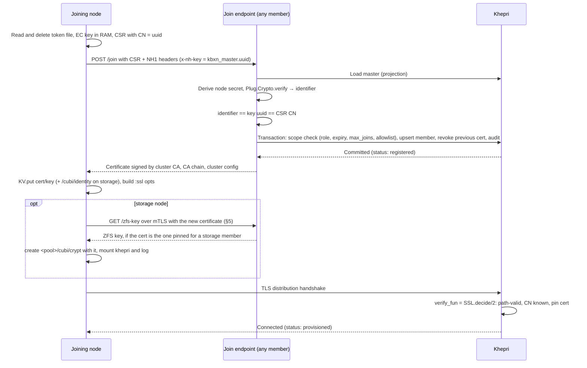

# Cubi cluster layer

Part of the cubi node boot plan: design in [specs.md](specs.md), open questions in [questions.md](questions.md), tests in [testing.md](testing.md).

Clustering is a separate layer on top of the node that [specs.md](specs.md)
specifies. It covers joining, membership, the cluster CA, Khepri and the
cluster-wide ZFS key. A node boots, keeps its state on its pool and runs
signed releases without any of it ([milestone 1](milestone1.md),
[milestone 2](milestone2.md)). This layer is [phase 7](phase7.md).

This design used to be §2.8, §2.9, §2.10.1, §2.10.2 and most of §2.10.4 of
specs.md. Those numbers are not reused there, so specs.md keeps its others. Here,
`§n` is this document's own sections, and `[specs §2.x](specs.md)` is the
node's.

**What the layer takes from the node:**

- a stable machine ID, the SMBIOS UUID, as hostname and Erlang node name
  `cubi@<UUID>` ([specs §2.6](specs.md));
- private files delivered as an extra initrd, never on the cmdline, which
  stage-1 moves to `/root/.cubi/` mode `0400` ([specs §2.4](specs.md));
- the per-node iPXE script rendered by the boot server
  ([specs §2.7](specs.md));
- on storage nodes, the pool and its reserved datasets: `/cubi/identity` in
  clear, and `/cubi/khepri` under the encryption root `crypt`, which the node
  unlocks with whatever key it is handed ([specs §2.10.3](specs.md),
  [§2.10.4](specs.md)).

---

## 1. The boot server's cluster roles

On top of serving images and per-node scripts ([specs §2.7](specs.md)), the
boot server is the one component outside the cluster that holds a join
secret. That makes it part of the trust boundary:

| Role | What it does |
| --- | --- |
| **Token derivation** | Holds the master tokens (§2.1) and derives each node's token from them, so a node never receives a master |
| **Token file** | Serves `node/${uuid}/token` (§2.2), only while that node needs one: always for diskless nodes, and until the first successful join for storage nodes |
| **Bootstrap OTP** | Renders `cubi.bootstrap=` for the first node, exactly once (§2.4) |

A joining node's script:

```ipxe
#!ipxe
set base https://boot.example/cubi/${version}
kernel ${base}/vmlinuz console=ttyS0 cubi.join=${join} cubi.vdevs=${vdevs}
initrd ${base}/stage1.cpio.zst
initrd ${base}/rootfs.squashfs /rootfs.squashfs
initrd https://boot.example/node/${uuid}/token /cubi/token
boot
```

The script leaves out the `initrd …/token` line for a provisioned storage node,
and `cubi.vdevs=` for a diskless one ([specs §2.10.3](specs.md)).

The boot server learns which storage nodes are provisioned from the cluster.
Either it calls `Cluster.status/1`, or the cluster pushes it the provisioned
UUIDs. The same feed keeps the cluster's allowlist (§2.1) in step with the
inventory, so the two agree on which machines exist.

The token file is per node and is not signed; HTTPS covers it. The server's
config is protected like a CA key, because it holds the masters.

## 2. Node credentials

A node gets everything it needs to join or create a cluster from three places:

| Source | Carries | Notes |
| --- | --- | --- |
| cmdline `cubi.join=<HOST>` | endpoint of an existing cluster: [architecture.md](architecture.md) §2's `bootstrap_endpoint` | not secret, fine to log |
| initrd file `/cubi/token` | this node's join token, `kbxn_<master id>.<uuid>:<secret>` (§2.1) | never on the cmdline (§2.2) |
| cmdline `cubi.bootstrap=<OTP>` | no cluster yet: this node creates one | single-use, spent minutes after boot (§2.4) |

The storage arguments (`cubi.vdevs=` and friends) are in [specs §2.10.3](specs.md). A storage
node that has already joined also has its key and certificate on its pool, in
`/cubi/identity`.

`cluster_boot` picks a mode at start:

| Has | Mode |
| --- | --- |
| identity on its pool | **rejoin**: straight to the distribution handshake, no token needed (§2.3) |
| `cubi.join=` + token file | **join** (§2.3) |
| `cubi.bootstrap=`, no `cubi.join=`, an empty pool | **bootstrap** (§2.4) |
| `cubi.bootstrap=` with a store already on the pool | refused: restarts its Khepri member instead ([specs §2.10.3](specs.md)) |
| `cubi.join=` **and** `cubi.bootstrap=` | refused: logged, then restricted. Guessing here could split a cluster |
| none of the above | **restricted**: BEAM runs, the node does nothing cluster-wise. This is what booting by hand in QEMU does, so phases [1](phase1.md)–[6](phase6.md) don't need a cluster |

### 2.1 Tokens: masters, per-node derivation, scopes

**Masters** are created by the bootstrap node, and later by
`Cluster.mint_token/1`. They are kept in Khepri at `[cubi, tokens, MasterId]`
(§4.1) and in the boot server's config. Nowhere else.

Each master is a `kbx_` key and a secret, in NervesHub's format (§3.2), plus a
scope:

| Scope | Effect |
| --- | --- |
| `role: storage \| diskless` | A diskless-role token can never produce a Khepri voter. A node becomes a voter only with a storage-role token **and** an operator's `Cluster.promote/1`, so no token alone changes quorum |
| `expires_at` | NH1 bounds each *request* to 90 s; this bounds the *master*. Rotating before expiry is routine |
| `max_joins` | Counted in the join transaction. For one-off masters handed out for a single new storage node |
| `allowed_ids` | Allowlist of SMBIOS UUIDs, kept in step with the boot server's inventory ([specs §2.7](specs.md)). A join for an unlisted UUID fails even with a valid secret. This is NervesHub's non-JITP mode, `maybe_jitp_device/2` with `jitp: nil` → `:device_not_registered` |

**Per-node tokens** are derived from a master. Nothing is stored per node, and
only the boot server and the cluster can compute one:

```
node_secret = HMAC-SHA256(master_secret, "cubi:node-token:v1:" <> uuid)
node_key    = "kbxn_" <> master_id <> "." <> uuid
```

- **This is NervesHub's per-device level** (`Devices.SharedSecretAuth`, next to
  the per-product `nhp_`), with the device's secret computed rather than
  stored.
- **NH1 on the wire is unchanged.** `node_key` is the `x-nh-key` header, which
  NH1 already binds into the signed salt.
- **A leaked node token** works for that one UUID only, and with an allowlist
  only on that machine's own identity. Using it from another machine means
  impersonating that UUID, which the join audit (§2.5) shows.

**Lifecycle:**

- **Rotate:** `Cluster.rotate_token(master_id)` mints a successor with the same
  scope, and the boot server is updated. The old master stays valid until a
  short overlap ends, then it is deactivated. Deactivating a master invalidates
  every node token derived from it at once.
- **Revoke:** deactivate immediately, without the overlap. Joins in flight fail
  (§3.2's subscribe-before-lookup ordering).

### 2.2 Delivering the token: an initrd file, never the cmdline

The kernel prints its command line to the kernel log at boot
(`Kernel command line: …`), and Nerves' `RingLogger` captures the kernel log.
`/proc/cmdline` stays world-readable for as long as the node runs. So the token
travels the way the squashfs does ([specs §2.2](specs.md)): iPXE wraps the token file into the
initramfs as `/cubi/token`.

1. **Stage-1** moves `/cubi/token` to `/newroot/root/.cubi/token` (tmpfs, mode
   `0400`) before `switch_root` deletes the initramfs.
2. **`cluster_boot`** reads the file, then deletes it, once the join attempt
   ends either way.
3. **The token never appears** in the cmdline, the kernel log or `ps`, and it
   is never logged.

For hand-booted QEMU before the boot server exists (phases [1](phase1.md)–[6](phase6.md)),
`cubi.token=<key>:<secret>` on the cmdline is accepted with a warning. Nothing
else uses it.

### 2.3 Join and rejoin

**Join (first time, and every boot of a diskless node).** `Cluster.join(join,
token)`, which follows §3.4. The cluster checks the node token against its
master's scope, and then issues a certificate whose CN is the node's UUID.

- **Diskless node:** the key and certificate live in RAM. The next boot is a
  fresh join with a fresh key, under the same UUID. The join replaces that
  member's certificate and revokes the old one, so no stale member is left
  behind.
- **Storage node:** the key and certificate are written to `/cubi/identity`.
  With that certificate it fetches the cluster's ZFS key and creates its
  encrypted datasets (§5). After the first join, the boot server stops
  serving it a token ([specs §2.7](specs.md)).

**Rejoin (storage node, identity on its pool).** No token is needed. The node
fetches the ZFS key with its stored certificate and unlocks its pool
(§5), then goes straight to the handshake half of §3.4, and Ra catches
up from its log. A
storage node that has lost its pool is a forced removal of the old voter
([architecture.md](architecture.md) §3). The boot server serves it a token again, and it joins as new.

Either way, a node that never comes back is expired by failure detection
(forced removal, [architecture.md](architecture.md) §3).

### 2.4 Bootstrap: the first node

The first node has nobody to join, so it proves its operator out of band. It
must be a storage node with an empty pool (§4.2).

1. The boot server renders this node's script with `cubi.bootstrap=<OTP>`, once.
   The operator who set it up knows the OTP.
2. The node starts BEAM and a **bootstrap web server**, and prints its address
   and the server's certificate fingerprint on the console. Nothing
   cluster-related runs yet: no distribution listener, no Khepri.
3. The operator opens the page, checks the fingerprint against the console, and
   types the OTP. The node compares it in constant time with the cmdline value.
4. On a match the node bootstraps:
   - It generates the cluster CA and its own node certificate, written to
     `/cubi/identity`.
   - It creates its pool, generates the cluster's ZFS key and creates
     `<pool>/cubi/crypt` with it (§5). The page does not show the key: it
     is exported separately, so that it never lands in the boot server's config
     with the masters.
   - It starts Khepri on `/cubi/khepri` with itself as the only member and
     voter ([specs §2.10](specs.md)), and writes the CA there.
   - It starts TLS distribution.
   - It mints two masters, one per role, each with an expiry, and its own UUID
     on their allowlists.
5. The page shows the two masters and the `cubi.join=` value, once. **They go
   into the boot server's config, not onto any node.** The operator then adds
   the other machines' UUIDs to the boot server's inventory, which syncs them to
   the allowlists.
6. The bootstrap web server stops, and the OTP is spent. A second correct entry
   is refused. After a reboot, the store on the pool makes the node refuse
   `cubi.bootstrap=` altogether ([specs §2.10.3](specs.md)). The boot server's render-once rule is
   a second line of defence.

Rules for the bootstrap web server:

- **HTTPS with a self-signed certificate.** Over plain HTTP, anyone on the
  segment reads the OTP as it is typed and the masters as they are displayed.
- **Rate-limit attempts** (for example 5, then exponential back-off). An OTP is
  short enough to type, which also makes it short enough to brute-force.
- **It never starts in any other mode.** The only way to reach it is
  `cubi.bootstrap=` on the cmdline, with an empty pool.

### 2.5 Audit, and what stays exposed

- **Every join is recorded** in Khepri: node key, UUID, source address, result.
  Failures are flattened to `:invalid_auth` for the caller, with the detail in
  telemetry (§3.2).
- **The signal that a node token was copied:** a join for a UUID that is already
  `provisioned`, from a different address.
- **Log `cubi.join=` freely.** Never log a token, an OTP or a master.
- **What remains exposed:**

  | Secret | Where it lives | Its limit |
  | --- | --- | --- |
  | **masters** | the boot server and Khepri on every voter | at rest on voters: §5 |
  | **a node token** | one node's tmpfs, between stage-1 and the end of its join | one UUID, one role, until its master expires |
  | **the OTP** | one node's cmdline | spent minutes after boot |
  | **the ZFS key** | RAM of unlocked storage nodes, the operator's export | served only to the certificate pinned for a storage member: §5 |
  | **a storage node's identity key** | in clear on its pool | fetches the ZFS key until that member is removed: §5 |

## 3. What to reuse from NervesHub: client and server

Both halves are Elixir and Apache-2.0, and both were read:

- **client:** `nerves_hub_link` 2.12.0 (`marmoos_os/deps/nerves_hub_link`);
- **server:** `nerves_hub_web` at `4f7df5a` (2026-10-27).

Registration lives in the server, so most of what cubi needs comes from there.
Copied files keep their SPDX headers, and cubi gets a `NOTICE` naming both
projects.

### 3.1 Two ways to use it

- **A. Run a real NervesHub as cubi's registration authority.** Nodes run
  `nerves_hub_link`, and cubi reads the device list from the NervesHub API.
  That makes an external server a hard dependency of `Cluster.join`, which
  contradicts the self-bootstrapping first node of §2.4. Half of what NervesHub
  does, firmware updates, cannot apply anyway, since boot images come from iPXE.
- **B. Copy both halves into cubi** (recommended). Every member runs the server
  half, with Khepri ([specs §2.10](specs.md)) in place of NervesHub's Postgres. Joining nodes run
  the client half.

Plan for **B**, and keep the NH1 wire format unchanged so that A stays possible
later for observability.

### 3.2 Server side: copied from `nerves_hub_web`

NervesHub registers a device in two ways, and cubi uses both, one after the
other:

| Piece | In `nerves_hub_web` | In cubi |
| --- | --- | --- |
| **NH1 verification** | `NervesHub.DeviceLink.Authentication.authenticate({:shared_secret, headers})` and `decode_from_headers/1`: rebuilds the salt, then `Plug.Crypto.verify(secret, salt, sig, max_age: 90)` returns the identifier | **Copy**, with one step changed: instead of looking up a stored secret, parse `kbxn_<master id>.<uuid>` from `x-nh-key`, load the master, and derive the node secret (§2.1). Then check that the verified identifier equals that UUID. Keep `cache: nil`: without it, Plug.Crypto caches one derived key per salt in ETS and never evicts, and NervesHub measured 41.5 MB after 12 days. Keep the failure flattening to `:invalid_auth` too |
| **Key/secret format** | `NervesHub.Products.SharedSecretAuth`: key `nhp_` + 43 chars, secret 43 chars, each `strong_rand_bytes(32)` base64 without padding; `deactivated_at` for revocation | **Copy the generator** for masters (`kbx_` prefix), with `deactivated_at` plus the scope fields of §2.1. Per-node `kbxn_` tokens are derived, not generated |
| **Per-device vs per-product secrets** | `Devices.SharedSecretAuth` (stored per device) next to `Products.SharedSecretAuth` (`nhp_`) | **Same two levels**, with the device level derived from the product level (§2.1), so nothing per node is stored |
| **Pre-registration** | `maybe_jitp_device/2` with `jitp: nil`: an identifier not created beforehand → `:device_not_registered` | **Copy** as the `allowed_ids` check (§2.1) |
| **Revocation racing a connect** | `DeviceSocket` subscribes to the key's topic *before* the lookup, so a deactivation racing a connect is never missed | **Same ordering** in the join endpoint, on the master's deactivation event (Khepri projection, §4.1) |
| **JITP at the TLS handshake** | `NervesHub.SSL.decide/2`, an `:ssl` `verify_fun`: find the signer by AKI → SKI, `:public_key.pkix_path_validation/3` against it, require a CN, look up the certificate by fingerprint, else the device by public-key fingerprint, else create the device from the CN; pin the certificate (fingerprint, serial, AKI/SKI, validity) | **Copy as the TLS distribution `verify_fun`** on every member. The CA lookup is the cluster CA, not a table, and "device" is the Khepri member record. A peer presenting a cluster-signed certificate becomes *provisioned* on its first distribution handshake: [architecture.md](architecture.md)'s "Report ready → Active membership", done in the handshake |
| **Safety rules in `decide/2`** | self-signed peer accepted only if pinned (`register: false`); deleted device → refused; one public key per device (`:unexpected_pubkey`); CN must match the existing device (`:mismatched_cert`) | **Keep all except one.** A new public key for a known UUID is a diskless reboot (§2.3). It is allowed only through a fresh NH1-authenticated join, which revokes the old certificate. The same key change arriving *without* a join is still refused |
| **`decide/2` needs no database** | split from `verify_fun/3` so that a TLS terminator with no database can ask over the cluster | **Fits as is.** On a storage node it reads Khepri projections locally (§4.1). A diskless node that accepts connections asks a storage node, the remote path NervesHub built it for |
| **`NervesHub.Certificate`** (176 lines) | AKI/SKI/CN/serial/validity/fingerprint/public-key-fingerprint helpers over `X509` | **Copy verbatim** |
| Ecto schemas, `Repo`, orgs/products, deployments, firmware, UI | — | **Leave behind.** `Devices.get_or_create_device/2` and `Certificates.*` become Khepri reads and transactions (§4.1) |

### 3.3 Client side: from `nerves_hub_link`

| Piece | In `nerves_hub_link` | In cubi |
| --- | --- | --- |
| **NH1 signing** | `Configurator.SharedSecret.headers/1`: `Plug.Crypto.sign(secret, salt, identifier, signed_at: os_time)` | **Copy.** `key` is the node key and `secret` the node secret. The secret never goes on the wire; only a 90-second HMAC of the UUID does |
| **Identifier** | `Nerves.Runtime.serial_number/0` | The SMBIOS UUID from [specs §2.6](specs.md)'s `boardid`: the NH1 identifier, the UUID in the node key, and the CSR's CN, all three checked equal |
| **Cert/key → `:ssl` options** | `Configurator.LocalCertKey`: reads `nerves_hub_cert` / `nerves_hub_key` from `Nerves.Runtime.KV` | **Adapt.** The cert and key live in the InMemory KV (`KV.put/2` works on that backend), loaded from `/cubi/identity` on a storage node. The `:ssl` list feeds TLS distribution |
| **Configurator behaviour** | NervesKey → TPM → SharedSecret | **Copy the shape**: `Cubi.Credentials`, tried in order `PoolIdentity` (rejoin), `TokenFile`, `Cmdline` (QEMU only). TPM and NervesKey drop in later for nodes with a sealed key, which can go straight to the handshake |
| Socket, extensions, remote IEx, `UpdateManager` / `fwup` | | **Not applicable**: peers talk over distribution, and updates are iPXE-side |

Copy the code rather than depending on either project: the client drags in
`fwup` and `slipstream`, and the server is an application, not a library.
Depend on `x509` and `plug_crypto` directly. `x509` also does what NervesHub
leaves to its CLI: `X509.PrivateKey.new_ec/1` and `X509.CSR.new/2` on the node;
`X509.Certificate.self_signed/2` and `new/4` for the CA and for signing.

### 3.4 The join, end to end

Two stages, matching NervesHub's two registration paths: **issuance**
(shared secret, over HTTPS) and then **admission** (JITP, in the distribution
handshake). A rejoining storage node skips issuance.



A few points:

- **The CSR is signed before the transaction.** Khepri transactions must be
  deterministic, so the transaction only records the signed certificate
  (§4.1). A transaction that aborts, on scope or a race, discards the
  certificate unissued.
- **The clock matters.** NH1 rejects signatures older than `max_age` (90 s), and
  scopes carry an expiry. Stage-1 doesn't set the time, so the join waits for
  `nerves_time` to sync, or trusts the RTC if the boot script says so. A wrong
  clock fails with a console message, not a silent retry loop.
- **`verify_fun` in TLS distribution** goes in the `-ssl_dist_optfile` as a
  fun, `{verify_fun, {fun 'Elixir.Cubi.SSL':verify/3, State}}`. OTP 29
  evaluates that file with `erl_eval` and hands it to `ssl` unchanged, so the
  `{Module, Function, State}` form is rejected there, and distribution then
  just fails to connect (`pang`) with nothing logged. That form is only parsed
  for `-ssl_dist_opt server_verify_fun` on the command line, which accepts a
  fixed whitelist of options and is not used ([phase 0](phase0.md)). The
  callback is arity 3, so `verify/3` is a thin wrapper over the stateless
  `decide/2`. The CN arrives as a UTF-8 binary.

## 4. Cluster state in Khepri

### 4.1 Khepri is the store, and the Raft

[Khepri](https://github.com/rabbitmq/khepri) is a tree-structured database
replicated with Raft through Ra. It is licensed Apache-2.0 OR MPL-2.0. At
0.19.x it is the default metadata store of RabbitMQ 4.2 and the only one from
4.3, but its API is not frozen before 1.0. It *is* [architecture.md](architecture.md) §4's
consensus-backed membership: there is no separate Raft to build.

Everything §3 called "membership" is a path in one store:

```
[cubi, members, Id]                         status (registered | provisioned | removed), voter?, addresses
[cubi, members, Id, certs, Fingerprint]     pinned cert: der, serial, aki, ski, validity   (decide/2)
[cubi, pki, ca]                             CA certificate + key (key at rest: §5)
[cubi, pki, crl]
[cubi, tokens, MasterId]                    master secret, scope (role, expires_at, max_joins, allowed_ids), join count, deactivated_at
[cubi, joins, Seq]                          audit: node key, uuid, source address, result   (§2.5)
[cubi, zfs_key]                             SHA-256 of the ZFS key, created_at, exported_at; never the key   (§5)
[cubi, key_fetches, Seq]                    audit: uuid, cert fingerprint, source address, result   (§5)
[cubi, config]                              cluster config returned by a join
```

How the copied NervesHub code (§3.2) maps onto it:

- **Ecto queries** become `khepri:get/2`. The writes, including the uniqueness
  NervesHub left to `devices_identifier_index`, become `khepri:transaction/2`.
  Transaction funs must be deterministic, so certificate signing happens
  *before* the transaction, which only records the result.
- **`decide/2` lookups and the revocation ordering** use projections: ETS tables
  that Khepri keeps in sync on every member. That way the TLS handshake never
  waits on a Raft round-trip, and a revocation reaches every member's table.
  Checked on 0.19.3 ([phase 0](phase0.md)): a projection registered once exists
  on every member, a rejoining or restarted member rebuilds it, and a delete
  clears the row everywhere. The table does not exist while the local store is
  stopped, so `decide/2` fails closed when `ets:whereis/1` returns `undefined`.
  Path patterns use `?KHEPRI_WILDCARD_STAR`. `'_'` registers fine and matches
  nothing. Triggers don't fit here: they run only on the leader, at least once.
- **Projections are slightly stale.** A certificate revoked a few milliseconds
  ago can still pass one handshake. Registration stays exact, because it is a
  transaction.

At the Khepri level, a node that is going to vote calls
`khepri_cluster:join(StoreId, RemoteNode)` after its admission (§3.4). That
call resets the local store first, which is what we want for a new member.

### 4.2 Only storage nodes vote

A Raft voter whose log does not survive a restart can forget votes and entries
it already acknowledged, and that breaks Raft's safety. Khepri's README states
the requirement: durable storage and stable node identities. So there are two
kinds of node:

| Node | Has | Khepri |
| --- | --- | --- |
| **storage** | `cubi.vdevs=` ([specs §2.10.3](specs.md)) | runs a member and may be a voter. Its Erlang node name is stable: `cubi@<SMBIOS UUID>`, from [specs §2.6](specs.md)'s `boardid` |
| **diskless** | nothing | runs no member. It reads and writes the store through a cubi API over distribution, served by a storage node. Its identity is fresh on every boot (§2) |

Consequences:

- **The bootstrap node must be a storage node.** Tolerating one failure needs
  three storage nodes ([architecture.md](architecture.md) §4). A cluster of diskless nodes only is not
  supported.
- **A storage node that loses its pool** (for example after a disk swap) is a
  forced removal of the old voter ([architecture.md](architecture.md) §3), followed by a fresh token join.
  Khepri resyncs its data from the cluster on that join.

### 4.3 What a storage node's pool gives the cluster


- **Rejoin without a token** (§2.3): `/cubi/identity` holds the key and
  certificate, so the boot server stops serving the node a token ([specs §2.7](specs.md)).
- **A local bootstrap guard** (§2.4): if `/cubi/khepri` already holds a store,
  `cubi.bootstrap=` is refused and the node restarts its member instead. A
  rebooted bootstrap node therefore can't create a second cluster.
- **A whole-cluster restart is recovery, not re-bootstrap.** Storage nodes
  import their pools, and Ra elects a leader once a majority is back. If every
  storage node went down, the first one back needs the exported ZFS key typed
  in (§5); partial restarts need nobody.

## 5. The cluster's ZFS key

The CA key and the token secrets sit on disk, on every voter. ZFS native
encryption closes that: `<pool>/cubi/crypt` is an encryption root
(`encryption=aes-256-gcm`, `keyformat=hex`, `keylocation=prompt`) holding
`khepri` and `log` ([specs §2.10.3](specs.md)). Its key is **one key for the whole cluster**,
kept on no disk. A storage node fetches it over HTTPS from the first node,
authenticated by its own client certificate, and the operator exports it for
disaster recovery.

**Where the key lives:**

| Place | When |
| --- | --- |
| RAM of every unlocked storage node | from its `zfs load-key` until shutdown, held by one process (`Cubi.ZfsKey`), redacted in `format_status/1`, never logged |
| the operator's offline copy | after `Cluster.export_zfs_key/0` |
| nowhere else | not in Khepri, which it encrypts, nor the boot server, nor `/cubi/identity` |

**Lifecycle:**

1. **Created at bootstrap** (§2.4): `:crypto.strong_rand_bytes(32)`, then the
   encryption root is created with it. Khepri records only
   `[cubi, zfs_key]`: its SHA-256, `created_at`, `exported_at`.
2. **Fetched at join** (§2.3): once issuance has returned a certificate, a
   new storage node fetches the key and creates its encryption root with it.
3. **Fetched at every boot** of a storage node: import, mount
   `<pool>/cubi/identity`, fetch, `zfs load-key -L prompt`, mount the
   children, start Khepri. The key reaches `zfs` on a stdin pipe and never
   touches a file.
4. **Exported** with `Cluster.export_zfs_key/0` while the cluster runs, from
   any unlocked storage node: the 64 hex characters, plus an audit record
   and a warning in the log (without the key). `Cluster.status/1` warns as long
   as `exported_at` is unset. Do it right after bootstrap. Until then, a
   power loss on every storage node at once loses the cluster.

**The key endpoint.** `GET /zfs-key` on the join endpoint's HTTPS listener
(§3.4). Every member serves it once its own pool is unlocked. The listener
asks for a client certificate without requiring one (`verify: :verify_peer`,
`fail_if_no_peer_cert: false`), because `/join` callers don't have one yet.
`/zfs-key` serves the key only if all of these hold:

- the certificate is path-valid against the cluster CA and not in the CRL;
- its fingerprint is the one pinned for its CN in
  `[cubi, members, Id, certs, …]`. Issuance pins one certificate per UUID and
  revokes the previous one (§2.3), so each node has a unique client
  certificate, and that certificate is the credential;
- the member is a storage node, `registered` or `provisioned`, not `removed`.
  Diskless nodes have no pool and are always refused.

Every fetch is recorded like a join (§2.5), and attempts are rate-limited
per source address. A fetch for a UUID whose node is already connected over
distribution is the signal that a disk and its identity were copied.

**The client side** runs in BEAM, over `:ssl` with the identity's key and
certificate, and verifies the server against the cluster CA, never a system
store. It tries the `cubi.join=` host, the first node, then the peer
addresses that the cluster keeps in `/cubi/identity/peers`, in turn. This is
what makes the first node's own reboot work: it has no `cubi.join=`, and gets
the key from a peer. `keylocation=https://…` was the other option. It would fix
one URL into a dataset property, configure client certificates through
environment variables, and report failures as an exit code.

**Cold start.** After a power loss of every storage node, no member holds the
key, so nothing is unlocked and Khepri has no quorum. A storage node that gets
no answer from any source starts an **unlock page**, with the bootstrap web
server's rules (§2.4): HTTPS with a self-signed certificate whose fingerprint
is on the console, rate-limited attempts. The operator pastes the exported key.
The node checks it with `zfs load-key -n` and unlocks, and the others, which
kept retrying in the background, fetch the key from it and unlock in turn. Ra
elects a leader once a majority is back. The first node serves before any
quorum exists, so `/zfs-key` decides from the local projections, rebuilt as the
member replays its own log **(verify)**. If they only fill once a leader
exists, the fallback is a CA-signed list of pinned fingerprints kept next to
the identity.

**What this protects, and what it doesn't:**

- **A disk taken off the network** is unreadable: its identity alone yields
  nothing without a member to answer.
- **A disk plugged back in somewhere that reaches the cluster** gets the key
  with the identity stored in clear on it, until that member is removed. The
  forced removal (§2.3) revokes its certificate, and from then on its disks
  are dead. Sealing the identity key in a TPM (the `Cubi.Credentials` slot of
  §3.3) closes this.
- **Rotation** is `Cluster.rotate_zfs_key/0`: a new key, `zfs change-key` on
  every storage node (it rewraps the dataset keys, nothing is re-encrypted),
  and a new export. Older exports stop working.

**With the export, the pool opens without cubi.** On any Linux with OpenZFS:
`zpool import -N <pool>`, then
`zfs load-key -L prompt <pool>/cubi/crypt`. Raw sends (`zfs send -w`) of
`<pool>/cubi/crypt/khepri` stay encrypted off-cluster, and the same export
opens them.
