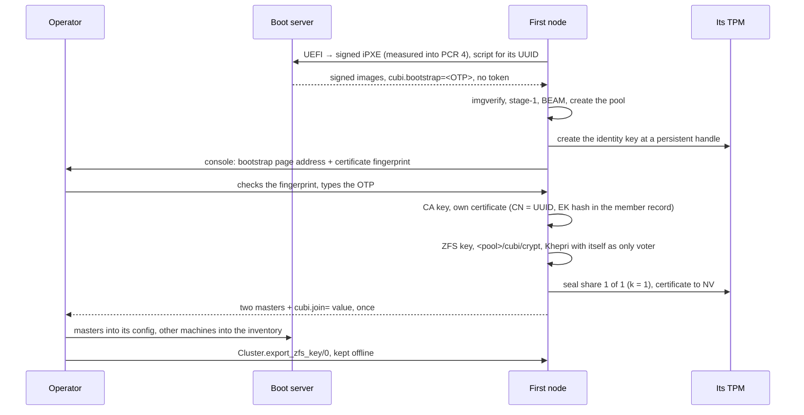
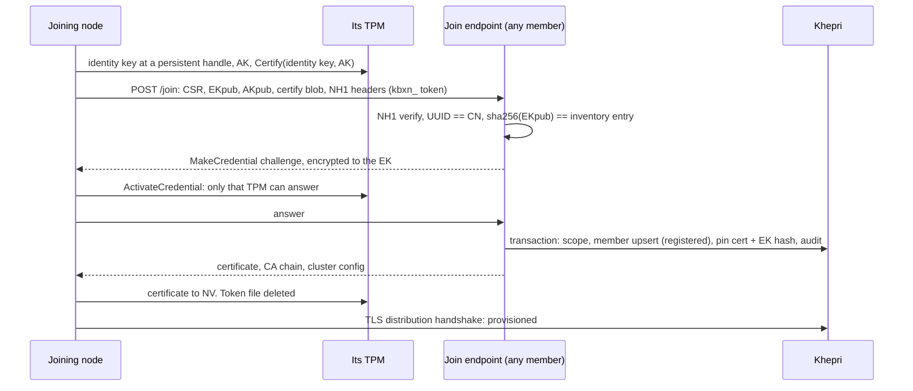

# Cubi node boot — security

Part of the cubi node boot plan: design in [specs.md](specs.md), open questions in [questions.md](questions.md), tests in [testing.md](testing.md).

This is the threat model of the recommended setup, and what happens to each
secret in three scenarios: the first node's boot, a node joining, and nodes
going down. §2.x numbers refer to [specs.md](specs.md); §1–§7 are this
document's own sections. Points marked
**(verify)** are assumptions to confirm before anything depends on them.

---

## 1. The recommended setup

- **Every machine has a TPM 2.0** (discrete or firmware) and boots over UEFI.
  Legacy BIOS boots work, but without the TPM properties below (§6).
- **At least three storage nodes** (`cubi.vdevs=`, §2.10.2): the Khepri
  voters, and the only machines with a pool.
- **Any number of diskless nodes**, which hold no persistent state and never
  vote.
- **One boot server** (§2.7), outside the cluster, holding the masters and
  the inventory.
- **One operator**, who holds the OTP at bootstrap and the exported ZFS key
  afterwards.

[specs.md](specs.md) describes the same cluster without a TPM. This document
adds the TPM, and §7 lists what it changes in the spec.

## 2. What is protected

| Secret | What it opens | Where it lives |
| --- | --- | --- |
| **Cluster CA key** | issuing any node identity | Khepri `[cubi, pki, ca]`, on every voter's encrypted dataset |
| **Masters** | deriving any node token in their scope | the boot server, Khepri `[cubi, tokens, …]` |
| **Node token** | one enrollment, for one UUID | one node's tmpfs, from stage-1 to the end of its join |
| **OTP** | bootstrapping a cluster | the first node's cmdline, spent minutes after boot |
| **Node identity key** | being that member: distribution, `/zfs-key` | **inside that machine's TPM**, never exportable |
| **ZFS key** | every storage node's `<pool>/cubi/crypt` | RAM of unlocked storage nodes; one Shamir share sealed in each storage node's TPM; the operator's export |
| **Image signing key** | what every machine will run | offline, with the operator. It never reaches the boot server or a node |

Cluster data (Khepri, logs, crash dumps) is only as safe as the ZFS key.
Workload data on the rest of the pool is out of scope here.

## 3. What the TPM holds

Every operation is a `tpm2-tools` command run through a port, against the
in-kernel resource manager `/dev/tpmrm0`. No `tpm2-abrmd` is needed.

| Object | Created | Used for |
| --- | --- | --- |
| **EK** (endorsement key) | by the manufacturer | naming the machine. The inventory records `sha256(EKpub)` next to the SMBIOS UUID, so a UUID alone no longer identifies a machine |
| **AK** (attestation key) | at first join, bound to the EK through `MakeCredential` / `ActivateCredential` | proving to the cluster that the identity key lives in *this* TPM (`TPM2_Certify`) |
| **Identity key** | at first join: ECC P-256 under the SRK, `fixedTPM \| fixedParent`, kept at a persistent handle (`0x81…`) | the TLS key for joins, distribution and `/zfs-key`. A persistent handle survives reboots without a disk, so diskless nodes keep their identity too |
| **Identity certificate** | issued by the cluster at join | stored in a TPM NV index. It is public, and keeping it there lets a diskless node boot straight into the handshake |
| **ZFS key share** | when a storage node becomes a voter, then at every reshare (§4.3) | a sealed object whose blob sits in clear on `<pool>/cubi/identity`. It unseals only in this TPM, under the PCR policy below |

**The PCR policy** used for sealing is authorized by a signature
(`PolicyAuthorize`) rather than fixed PCR values. Each release ships the PCR
values it predicts, signed with the image signing key (or a sibling key). A
new kernel or iPXE build therefore never forces a reseal on every node. The
measured PCRs:

- **PCR 7**: Secure Boot state and keys;
- **PCR 4**: the boot applications the firmware started: our signed iPXE,
  and, when iPXE starts the kernel's EFI stub through `LoadImage`, the kernel
  too **(verify)**.

The cmdline and the initrds are not covered by those PCRs, so the boot
script stays unsigned. That makes §5's hardening rules mandatory.

**How `:ssl` signs with a key it cannot read.** `ssl` accepts
`key => #{algorithm => ecdsa, engine => Engine, key_id => Handle}` through
`crypto`'s engine API, backed by `tpm2-tss-engine`. OpenSSL 3 deprecates
engines in favour of providers (`tpm2-openssl`) **(verify** which one OTP 29's
`crypto` can drive, and whether Buildroot packages it**)**. TLS distribution
takes the same option in `-ssl_dist_optfile`.

## 4. Scenarios

### 4.1 First node boot

The machine is in the boot server's inventory (UUID + EK hash), with a blank
pool and `cubi.zfs.create=1`. The boot server renders its script with
`cubi.bootstrap=<OTP>`, once.

1. **Before the OTP is typed,** only the page listens: no distribution and no
   Khepri. A wrong OTP costs the attacker the rate limit (§2.8.4).
2. **The node's own certificate** is self-issued from the new CA. It still
   records its EK hash, so a later machine presenting the same UUID with a
   different TPM is refused.
3. **With one voter, k = 1**: the one share *is* the ZFS key. This machine can
   unlock on its own, so stealing it whole steals the cluster. The window
   lasts until two more storage nodes are voters, and `Cluster.status/1`
   reports it.
4. **The page doesn't show the ZFS key.** The export is a separate step, done
   right away. Until then, losing this TPM loses the cluster.

**State afterwards:**

| Secret | Where |
| --- | --- |
| CA key, masters | Khepri on the first node (encrypted dataset), masters also on the boot server |
| OTP | spent. A reboot refuses `cubi.bootstrap=` because the pool holds a store |
| identity key | the first node's TPM |
| ZFS key | its RAM, its TPM (sealed, k = 1), the operator's export |

### 4.2 A node joining

The machine is in the inventory (UUID + EK hash), and its UUID is synced to the
allowlist of a master of its role. The boot server serves it a token file,
derived from that master (§2.8.1), until its first join succeeds. **With a
TPM, this is the only time any node receives a token**, diskless or storage.

What the challenge proves, step by step:

- **NH1** proves the caller holds a token derived for that UUID (§2.9.4).
- **The EK hash** proves the TPM is the one the operator inventoried.
- **`ActivateCredential`** proves the AK lives in that TPM, and `Certify`
  proves the identity key does too, with `fixedTPM`. The cluster thus signs a
  certificate for a key that can never leave that machine.

**Diskless node.** After the handshake it is a client of the store over the
cubi API (§2.10.2). It never asks for the ZFS key: `/zfs-key` refuses every
diskless member. On its next boot it goes straight to the handshake with the
key and certificate from its TPM. There is no token file, no fresh key, and
the member record is not replaced (§4.3).

**Storage node.** It stays `registered` and doesn't fetch the ZFS key until an
operator runs `Cluster.promote/1`. Then:

1. It fetches the ZFS key from `/zfs-key` over mTLS with its TPM key
   (§2.10.4), creates `<pool>/cubi/crypt`, and starts Khepri, which joins as a
   voter (`khepri_cluster:join/2`).
2. **Reshare.** The voter set changed, so the member holding the key computes
   a new Shamir split of the same key: n = voters, k = ⌊n/2⌋ + 1. Each share
   goes to its node over distribution. Every node seals its own share in its
   TPM, writes the blob to `/cubi/identity`, deletes the previous one, and
   acks. Once every node has acked, the epoch commits in Khepri.
3. **The roster.** With the new epoch, the CA signs a roster: the epoch, k,
   the ZFS key's SHA-256, and each voter's UUID, certificate fingerprint and
   address. Every storage node keeps it in clear in `/cubi/identity`. Cold
   start (§4.3) authenticates peers against it, because Khepri cannot answer
   then.

Promotion has to come before the key fetch. Otherwise the boot server alone,
which holds the masters *and* feeds the allowlist, could enroll a machine of
its choosing as a storage node and collect the key.

**State afterwards:**

| Secret | Where |
| --- | --- |
| node token | gone: the file is deleted, and the boot server serves none to a provisioned node |
| identity key | the new node's TPM |
| ZFS key | RAM of every storage node, one share sealed in each storage TPM (new epoch), the operator's export |
| CA key, masters | Khepri on every voter, now including the new one |

### 4.3 Nodes going down

Ordered from routine to catastrophic.

| Event | What happens | Who has to act |
| --- | --- | --- |
| **A diskless node reboots** | Handshake with its TPM identity. Same member, same certificate. The stale-member expiry of [phase 7](phase7.md) only applies to nodes without a TPM | nobody |
| **A storage node reboots, quorum holds** | Import the pool, fetch the ZFS key from `/zfs-key` (the `cubi.join=` host, then the roster's peers) with its TPM key, unlock, rejoin Khepri, Ra catches up | nobody |
| **A minority of storage nodes is down** | The cluster runs. Each returning node unlocks as in the row above | nobody |
| **A majority of storage nodes is down** | No quorum: no joins, no writes. The surviving storage nodes still hold the key in RAM and serve `/zfs-key` from the roster, so returning nodes unlock and quorum comes back | nobody, as long as one storage node stayed up |
| **Every storage node is down** (power loss) | Cold start from the shares, below | nobody, if k storage machines come back with their TPMs intact |
| **Fewer than k storage machines can come back** | Not enough shares. The unlock page (§2.10.4) accepts the exported key on any storage node, and the others fetch from it | the operator, with the export |
| **A firmware update changed the PCRs** | That node's share no longer unseals. If the cluster is up it fetches the key, reseals and carries on. During a cold start it counts as missing a share | nobody, unless it happens during a cold start |
| **A machine is lost for good** (dead, stolen, decommissioned) | Forced removal (§2.8.3): revoke its certificate, drop its EK hash from the inventory, reshare to the remaining voters, then `Cluster.rotate_zfs_key/0` (`zfs change-key` everywhere), which also invalidates every older share and the previous export | the operator: removal, then a new export |
| **Motherboard or TPM replaced, disks kept** | New EK: the inventory must be updated by hand. Re-enroll with a token, and the pool unlocks with the new identity's fetch. The hostid derives from the SMBIOS UUID, so if that changed too the import needs a deliberate `-f` (§2.10.3) | the operator |

**Cold start in detail.** Every storage machine boots, imports its pool and
unseals its own share. It reads its roster, then connects over mTLS to the
roster's other members. Both sides verify against the CA and the roster's
fingerprints. If a peer presents a newer CA-signed roster, that one wins, so a
node that was down during a removal learns of it before handing out its share.
Each node hands its share only to peers on the winning roster. Once a node
holds k shares of the same epoch, it reconstructs the key, checks it against
the roster's SHA-256, unlocks, and serves `/zfs-key` to the rest. Ra elects a
leader once a majority is back, which takes the same k machines.

**What a stolen machine yields**:

- **its disks alone:** nothing. The identity key and the share only work in
  its TPM;
- **the whole machine, with the cluster down or out of reach:** one share,
  short of k (k = 1 only in the window of §4.1);
- **the whole machine, with the cluster reachable:** the key, through
  `/zfs-key`, *until its removal*. Revocation still has to happen. The TPM
  narrows this case to whole-machine theft but cannot close it.

## 5. Hardening rules

The PCR policy measures the boot chain up to the kernel, not the cmdline or
the initrds. Anyone controlling the network can serve our signed images with
any cmdline. A machine in that state unseals its share like a legitimate boot,
so nothing in the image may hand an attacker a shell:

- **Stage-1 must not drop to a shell** on failure (§2.4 does today). On a
  production image it prints the error and reboots after a delay.
- **No console IEx on production images.** erlinit's console runs a read-only
  status screen. Remote IEx goes over distribution, which needs an identity.
- **Stage-1 always `switch_root`s to erlinit**, ignoring `init=`, with no
  arguments and a clean environment. The kernel hands unknown `key=value`
  cmdline arguments to init as environment variables. Without `env -i`, a
  cmdline `ERL_AFLAGS=…` reaches the BEAM as VM arguments (checked in
  `apps/cubi_e2e/test/stage1_test.exs`).
- **`rdinit=` is chosen by the kernel, before stage-1 runs**, and the kernel
  passes leftover cmdline words to it as `argv`. With busybox in the
  initramfs, `rdinit=/bin/busybox sh` is a root shell with the token still in
  `/cubi/token` (checked in QEMU). Stage-1 cannot prevent that. A production
  initramfs therefore holds no busybox: stage-1 becomes the small static C
  program §2.4 anticipates ([phase 5](phase5.md)), so that `rdinit=` can only
  name `/init` or a non-executable file.
- **Only `cubi.*` arguments, `console=` and a short allowlist are read**,
  and none of them can grant a shell or disable a check.
  `cubi.token=` and `cubi.zfs.testkey=` are compiled out of production
  images.
- **Signing the per-node scripts with `imgverify`** would close this
  properly, but it puts a signing key online on the boot server. It is left
  out of v1.

The rest of §2.7 still applies unchanged: HTTPS after the chainload step,
`imgverify` on every image, and the boot server's config protected like a CA
key.

## 6. Residual risks

| Attacker | Gets | Mitigation |
| --- | --- | --- |
| **On the network segment** | nothing: everything after the chainload is HTTPS, joins are NH1-signed, distribution is mTLS | serve the chainload step from a dedicated VLAN |
| **Holds a leaked node token** | nothing without the machine: the EK check fails | rotate the master (§2.8.1) |
| **Root on a diskless node** | that node's identity while it runs, the cubi API's reach | the API's authorization (out of scope here) |
| **Root on a storage node** | everything: CA key, masters, ZFS key in RAM | remove it and rotate the CA, masters and ZFS key. The TPM doesn't help against a live compromise |
| **Controls the boot server** | the masters, the inventory, and so the allowlist. It can make a machine of its choosing join as **diskless** | storage enrollment still needs `Cluster.promote/1` before any key fetch (§4.2) |
| **Controls the boot server and the network** | can boot our machines with a hostile cmdline | §5's hardening rules |
| **Machine without a TPM in the cluster** | its identity key is in clear on its pool, or fresh in RAM for diskless (spec as written) | count only TPM machines in k. A machine without a TPM gets no share and uses the unlock page at cold start |
| **Steals the operator's export** | the ZFS key: every pool in the cluster | keep it offline like the image signing key, and rotate after any doubt |

## 7. What this changes in specs.md

To be folded into the spec once agreed:

- **§2.8.3:** with a TPM, diskless nodes keep their identity across reboots,
  and the token file is served only until the first join, whatever the role.
- **§2.9.3:** `Cubi.Credentials` gains the `Tpm` configurator, tried first.
- **§2.9.4:** the join gains the EK check and the `MakeCredential` round-trip.
- **§2.10.3:** `/cubi/identity` holds the certificate, the CA chain, the
  sealed share blob and the signed roster, but no private key.
- **§2.10.4:** `/zfs-key` serves storage members only once promoted, not while
  `registered`. Cold start uses the shares first and the unlock page as the
  fallback. The `(verify)` on projections without a leader disappears: peers
  are authenticated against the roster.
- **§2.4:** no shell on stage-1 failure in production images.
- **§2.10.5:** `tpm2-tss`, `tpm2-tools` and the TPM engine or provider in the
  system fork; `TCG_TIS` / `TCG_CRB` in the kernel delta (§2.5).
- **[testing.md](testing.md):** `swtpm` per QEMU VM, with tests for stolen-disk,
  replayed-token and cold-start cases.
