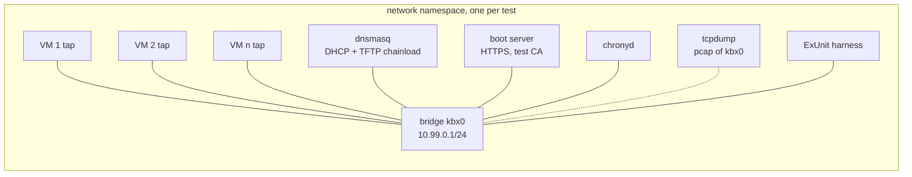

# Cubi node boot — test infrastructure

Every acceptance bullet in the phase files is an automated test that boots real
images in QEMU with KVM. The same tests run on a workstation and in CI. Design
in [specs.md](specs.md), open questions in [questions.md](questions.md).

Nothing here is built yet. Points marked **(verify)** are checked in
[phase 0](phase0.md).

## 1. Layers

| Layer | What it covers | Runs | When |
| --- | --- | --- | --- |
| **unit** | pure Elixir: cmdline parsing, NH1 sign/verify, token derivation, `decide/2`, scope checks, Khepri transactions against a local single-node store | `mix test` on the host | every commit |
| **e2e, tier 1** | one VM, user-mode networking: boot paths, stage-1, `mix firmware.ipxe`, BIOS and UEFI, storage | `mix test --only e2e:tier1` | every PR |
| **e2e, tier 2** | several VMs in a network sandbox with DHCP, the real boot server and NTP: hardened boot, the join, faults | `mix test --only e2e:tier2` | main and nightly |
| **hardware** | [phase 8](phase8.md): NIC coverage, consoles, boot time on a physical box | manual checklist | per release |

Unit tests come first wherever they can: an e2e test proves the parts are wired
together, not that every branch is right.

## 2. The harness: `cubi_e2e`

This is a host-only app in the cubi umbrella (`apps/cubi_e2e`), never a dependency of the firmware. It drives QEMU
from ExUnit. It is not part of any firmware.

| Module | Job |
| --- | --- |
| `Cubi.E2E.VM` | Builds the QEMU argv from a spec (§5) and starts it under `MuonTrap`. Exposes QMP over a unix socket (`-qmp unix:…,server=on,wait=off`) for reset, power, link and block control |
| `Cubi.E2E.Console` | The serial console (`-chardev socket,…` + `-serial chardev:…`), copied to a log file. Expect-style matching: `await(vm, ~r/Kernel command line/, 30_000)` |
| `Cubi.E2E.Node` | Runs Elixir on the guest over `nerves_ssh` exec with the harness key (§3). `eval(vm, "Nerves.Runtime.firmware_valid?()")` returns a term, sent back through `:erlang.term_to_binary/1` + Base64, so it isn't scraped from IEx output |
| `Cubi.E2E.Sandbox` | Tier 2's network namespace: bridge, taps, dnsmasq, boot server, NTP, packet capture (§4.2) |
| `Cubi.E2E.Disk` | qcow2 fixtures: blank, pre-partitioned ("dirty"), and pools carried over between boots (§5). `restart_vm!/2` in the case template power-cycles a machine onto the same disks |
| `Cubi.E2E.Cluster` | N-VM fixture with helpers: `bootstrap/2` (drives the OTP page), `boot_storage/2`, `boot_diskless/2`, `restart_all/1`, `voters/1` |
| `Cubi.E2E.Leak` | Scans every serial log, the packet capture and each guest's `/root` for every secret the test minted: masters, node tokens, OTPs and the ZFS key ([specs §2.8.5](specs.md), [§2.10.4](specs.md)). For the ZFS key it also scans the raw disk images |

Each test gets its own directory under `_build/e2e/<module>/<test>/`, holding
disks, logs (`console.log`, `qmp.log`), the QEMU argv and the capture. It is
wiped when the test starts and kept afterwards. The QMP and console sockets
are not in it. Unix socket paths are limited to 108 bytes, a checkout path plus
a test name easily exceeds that, and the harness must connect to the sockets
too, so they go in a short private directory, `$XDG_RUNTIME_DIR/kbx-<random>/`
(mode 0700), removed when the VM stops. QEMU starts paused (`-S`) and is
resumed over QMP once the console is attached, because a `wait=off` chardev
drops whatever the guest prints before a client connects. With
`CUBI_E2E_KEEP=1`, the VMs are left running too, and
`mix cubi.e2e.console <test> <vm>` attaches to one.

## 3. Test firmware: `MIX_ENV=e2e`

The tests boot the same image as production, with exactly three differences:

- **`nerves_ssh` with the harness's public key**, for `Cubi.E2E.Node`. In
  production, ssh is either off or uses operator keys.
- **NTP pointed at the sandbox** (§4.2), since the sandbox has no internet.
- **Signed with a test CA, not the production one.** A production iPXE
  (`TRUST=` + `imgverify`, [specs §2.7](specs.md)) refuses an e2e image, so a
  test build can never be booted by mistake on a real boot server.

There are no test-only code paths in cubi itself: no `cubi.test=1` flag, and
no backdoor in `cluster_boot`. What the tests check is what ships.

## 4. Networking

### 4.1 Tier 1: user-mode networking, one VM

The VM uses QEMU's built-in `-netdev user`:

- **No root needed**, and no setup on the host.
- **Phase 1** skips the network entirely: `-kernel` / `-initrd` / `-append`.
- **Phase 4 over TFTP:** `-netdev user,id=n0,tftp=<ipxe dir>,bootfile=boot.ipxe`,
  using QEMU's iPXE NIC ROM.
- **Phase 4 over HTTP:** a small Bandit server on host loopback
  (`Cubi.E2E.HttpServer`), which the guest reaches as `10.0.2.2`; the DHCP
  filename is the `boot.ipxe` URL. The server logs every request to `http.log`.
- **UEFI:** OVMF's PXE client can only run an EFI binary, so the VM gets a TFTP
  root of its own with `ipxe.efi` (`mix cubi.e2e.ipxe`) and an `autoexec.ipxe`
  that runs `dhcp` and chains `boot.ipxe`, by TFTP or by URL ([phase 4](phase4.md)).
- **BIOS consoles:** the harness sets SeaBIOS's `etc/sercon-port` fw_cfg item
  to ttyS0, so SeaBIOS and iPXE's messages reach `console.log` as they do under
  `-nographic`. The value is a raw little-endian integer, so it is passed as a
  file.
- **ssh:** `hostfwd=tcp:127.0.0.1:<free port>-:22`, with the free port
  allocated by the harness.

### 4.2 Tier 2: the network sandbox



- **One namespace per test**, so tier-2 tests run in parallel without sharing
  addresses or leaking traffic into the host network.
- **dnsmasq is the sandbox's only DHCP server.** It hands out `undionly.kpxe`
  or `ipxe.efi` by client architecture (option 93) over TFTP, then, once iPXE
  asks, the per-node script URL. This is the same two-step chainload as
  production ([specs §2.7](specs.md)), with full DHCP instead of proxy-DHCP. A
  separate tier-2 test runs dnsmasq in proxy mode next to a plain DHCP server.
- **The boot server is the real one** from phases 5 and 7, configured with the
  test CA and an inventory generated by the fixture. Tests also put it in
  "misbehave" modes: serving a tampered squashfs, a token for the wrong UUID, or
  a stale script.
- **The harness itself runs inside the namespace**, so it reaches the VMs' ssh
  and the bootstrap web page directly.

**Getting into a namespace without root.** The plan is
`unshare --user --map-root-user --net --mount`, which gives a private network
stack in which `ip link add kbx0 type bridge` and tap devices just work. Two
hosts need handling:

- **This workstation has `kernel.apparmor_restrict_unprivileged_userns = 1`**
  (Ubuntu's default since 24.04). That blocks unprivileged user namespaces for
  unconfined programs, so the harness's launcher needs a small AppArmor profile
  that grants `userns`. Lifting the restriction machine-wide would also work,
  but is broader than the harness needs.
- **CI runners** have passwordless sudo, so the job sets the sysctl to `0`
  before the tests.

KVM inside the user namespace is checked against the real user's credentials,
and here `/dev/kvm` carries an ACL for the logged-in user. QEMU with KVM boots
fine inside a `bwrap` user namespace ([phase 0](phase0.md)). That same test shows
why the harness needs its own profile: `bwrap`'s shipped AppArmor profile allows
the namespace but drops `CAP_NET_ADMIN`, so creating the bridge and the taps
fails with EPERM.

If neither works, the fallback is a one-time `sudo ip netns add` per worker,
then running the harness through `ip netns exec`.

## 5. Machine fixtures

A VM spec describes one machine. It is deterministic, so a reboot is the same
machine:

```elixir
%Cubi.E2E.VM{
  name: "s1",
  uuid: "6f1c…",              # -uuid and SMBIOS type 1: boardid, node name, token derivation
  mac: "52:54:00:99:00:01",   # derived from the index
  firmware: :bios | :uefi,    # SeaBIOS, or OVMF_CODE_4M.fd with a per-VM copy of OVMF_VARS_4M.fd
  memory: 1024,
  disks: [{:virtio, "KBXD0", :blank}, {:nvme, "KBXN0", :dirty}],
  rtc: :host | {:skew, ~U[2020-01-01 00:00:00Z]},
  boot: {:direct, kernel, initrds, cmdline} | {:pxe, :tftp | :http, served_dir}
}
```

That produces, among other options:

```
qemu-system-x86_64 -machine q35,accel=kvm -cpu host -m 1024 -nographic \
  -uuid 6f1c… -smbios type=1,uuid=6f1c… \
  -drive if=none,id=d0,file=d0.qcow2 -device virtio-blk-pci,drive=d0,serial=KBXD0 \
  -drive if=none,id=d1,file=d1.qcow2 -device nvme,drive=d1,serial=KBXN0 \
  -netdev tap,id=n0,ifname=s1,script=no,downscript=no -device virtio-net-pci,netdev=n0,mac=52:54:00:99:00:01 \
  -chardev socket,id=con,path=con.sock,server=on,wait=off -serial chardev:con \
  -qmp unix:qmp.sock,server=on,wait=off
```

- **Disk serials are set explicitly** (`serial=`), so the sysfs resolution of
  `cubi.vdevs=` ([specs §2.10.3](specs.md)) is tested against known names, on
  both virtio-blk and NVMe.
- **Disk kinds:** `:blank` is an empty 8G sparse qcow2 (`<pool>/cubi`
  reserves 4G), `:dirty` the same with a GPT written by `sfdisk`, and a path is
  an image the test made itself. A stale ZFS label needs no fixture: a pool
  left on kept disks is one (`phase6_storage_test.exs` asks for another pool
  name over it). These are for the "must refuse to create" cases;
  `Disk.digest!/1` checks a refused disk was not written.
- **Pools survive reboots** because the images, `disk-<serial>.qcow2` in the
  VM's directory, are made when missing and kept otherwise, for the test's
  lifetime. A "disk swap" is `Disk.discard!/2` before a restart: a fresh blank
  disk under the same serial.

## 6. Fault injection

| Fault | How |
| --- | --- |
| reboot | QMP `system_reset` |
| crash | QMP `quit`, or `SIGKILL` to QEMU |
| graceful shutdown | `Nerves.Runtime.poweroff/0` over `Cubi.E2E.Node`. QMP `system_powerdown` does nothing: the kernel registers the ACPI power button, but nothing in erlinit or Nerves listens for it ([phase 0](phase0.md)). If cubi starts handling `KEY_POWER` itself, so that storage nodes export their pool when a hypervisor or a finger asks, this row switches to QMP |
| network partition | QMP `set_link n0 off`; `tc netem` on the VM's tap for latency or loss |
| freeze (GC pause, overloaded host) | QMP `stop`, then `cont` |
| whole-cluster restart | `Cubi.E2E.Cluster.restart_all/1`: kill every VM, keep their disks |
| disk loss | QMP `blockdev-del`, or a restart with a new blank disk |
| wrong clock | `rtc: {:skew, …}` with the sandbox NTP stopped. The NH1 join must fail with a console message ([specs §2.9.4](specs.md)) |
| tampered or wrong artifacts | the boot server's misbehave modes (§4.2) |

## 7. Acceptance → tests

| Phase | Test file | Tier | Main fixtures |
| --- | --- | --- | --- |
| [1](phase1.md) | `apps/cubi_e2e/test/phase1_direct_boot_test.exs` | 1 | `boot: {:direct, …}`; asserts `firmware_valid?`, read-only `/` |
| [2](phase2.md) | `phase2_system_fork_test.exs` | 1 | the same test, against artifacts from the fork |
| [3](phase3.md) | `phase3_firmware_ipxe_test.exs` | unit + 1 | the output directory's contents, then a boot from it |
| [4](phase4.md) | `phase4_netboot_test.exs` | 1 | TFTP and HTTP × BIOS and UEFI, no disk |
| [5](phase5.md) | `phase5_boot_chain_test.exs` | 2 | tampered squashfs refused; script per UUID; proxy-DHCP next to plain DHCP |
| [6](phase6.md) | `phase6_storage_test.exs` | 1 | blank mirror created; reboot keeps Khepri data; dirty disk and missing `cubi.zfs.create=1` refused |
| [7](phase7.md) | `phase7_cluster_test.exs` | 2 | bootstrap through the web page; 3 storage + 1 diskless; each refusal case; A's token presented as B; `/zfs-key` refusals; `Cubi.E2E.Leak` over everything; first node restarted alone; whole-cluster restart through the unlock page; exported key opens a disk image outside cubi |

A failing acceptance bullet names its test, and the test names the bullet in
its `@moduledoc`.

## 8. CI

- **Build cost.** The Nerves system build is about an hour from scratch. Publish
  the system artifact the way `marmoos_system_rpi3` does (`artifact_sites` →
  GitHub releases) and cache `~/.nerves`, so a CI run only builds the firmware.
- **KVM.** GitHub's Linux runners expose `/dev/kvm` once a udev rule opens it
  to the runner user **(verify** on the current runner images**)**. Without
  KVM, QEMU falls back to TCG, which is too slow for tier 2.
- **What runs when:**
  - tier 1 on every PR;
  - tier 2 on main and nightly. Four VMs at 1 GiB each fit a standard runner.
- **Artifacts on failure:** serial logs, the QMP event log, the pcap, dnsmasq
  and boot server logs, and the test's spec dump.
- **Boot time is measured on every run**, from QEMU start to the IEx prompt
  and to cluster join, and reported. A budget assertion catches regressions
  such as a bigger squashfs or a slow stage-1.

## 9. On this workstation

| Check | State |
| --- | --- |
| QEMU | 10.2.1 |
| dnsmasq | installed |
| OVMF | `OVMF_CODE_4M.fd` and `OVMF_VARS_4M.fd` in `/usr/share/OVMF/` |
| `/dev/kvm` | `root:kvm` with an ACL |
| unprivileged user namespaces | restricted (`apparmor_restrict_unprivileged_userns = 1`): tier 2 needs the AppArmor profile from §4.2 |
| `chronyd`, `tcpdump` | installed |
